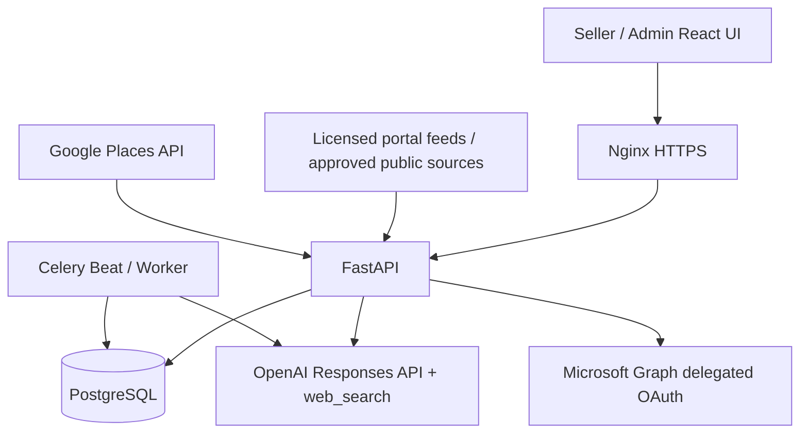

# Architecture and data flow

## Agent responsibilities
- Discovery: identify candidate public opportunities and retain citations/source metadata.
- Email intelligence: triage authorised mailboxes, extract property enquiry intent, never infer consent.
- Owner verification: separate authoritative ownership proof from property address and unverified hypotheses.
- Qualification: rank evidence quality, recency, territory relevance and lawful contactability.
- Communication: create drafts only; seller approval and compliance gate required.
- Follow-up: schedule seller tasks and monitor replies only after mailbox integration is completed.

## Trust boundaries
Treat portal pages, email bodies, attachments and search results as untrusted data. Never execute instructions found in source content. Do not allow an agent to send email, export contact lists or change permissions. All external communication remains a human-approved action.

## Workspace branding
The dashboard branding is configurable at runtime. The default is `ThinkSmart AI | Loft2 Real Estate`; administrators can edit the product/customer names, tagline, logo URL and brand colours. A singleton PostgreSQL `brand_settings` record is used for this single-customer deployment. The branding GET endpoint exposes display-only values for the login page; the update endpoint requires the administrator role. For a future multi-customer SaaS release, replace the singleton with tenant-scoped settings and enforce tenant IDs on every business table/query.
